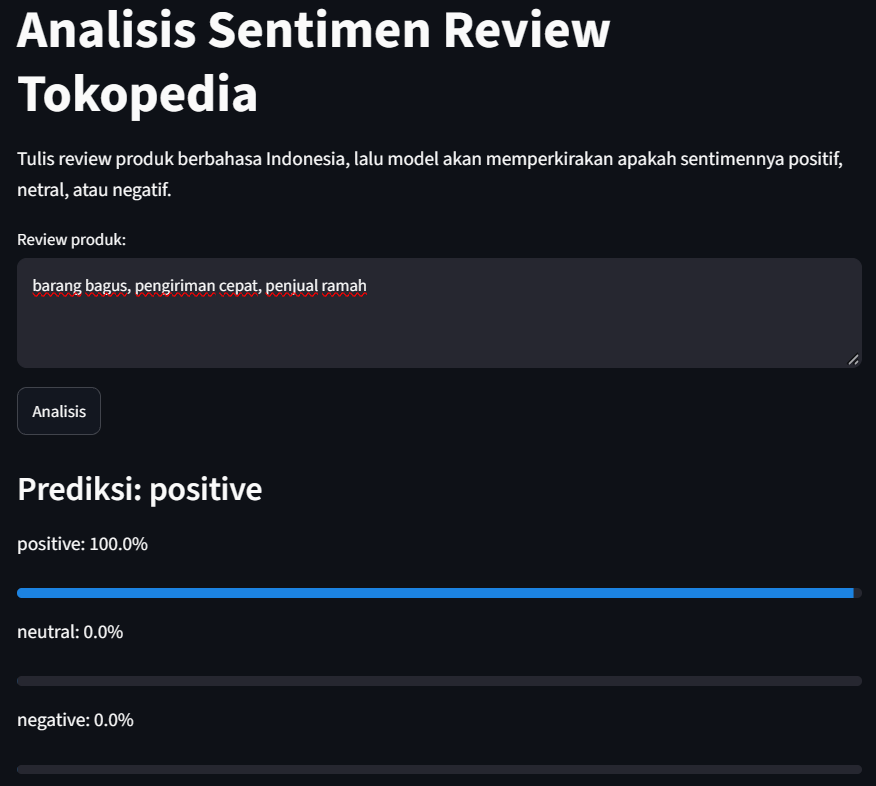
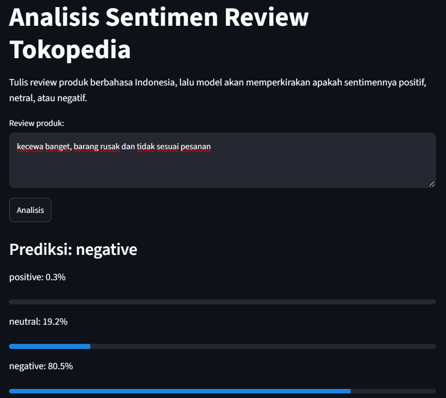
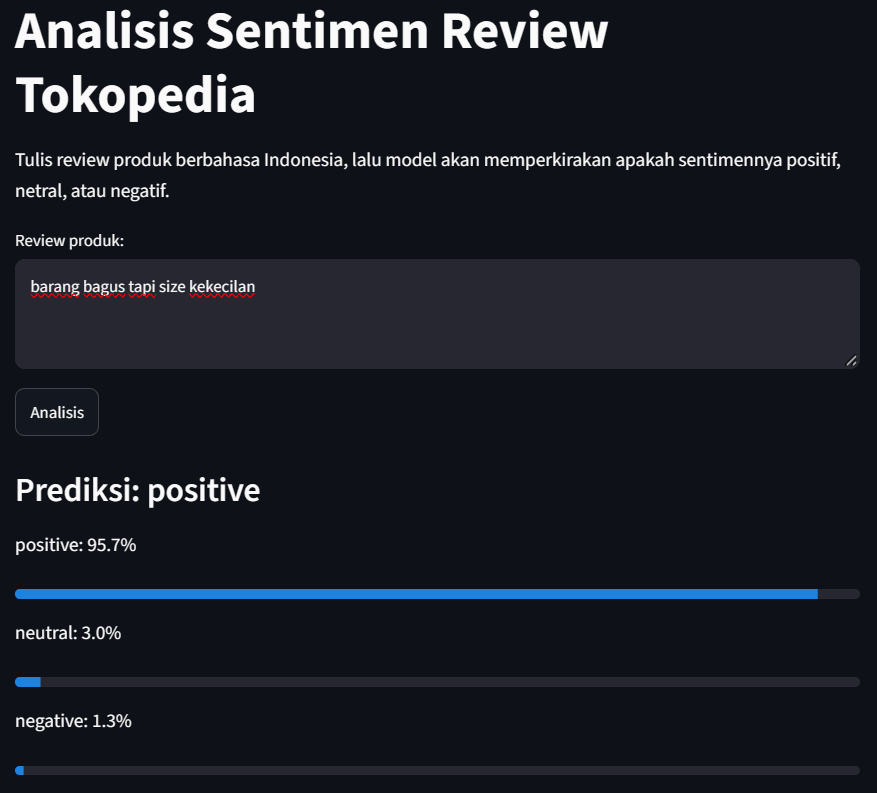

# Analisis Sentimen Review Tokopedia (Bahasa Indonesia)

Model machine learning yang memperkirakan sentimen review produk berbahasa Indonesia: **positif**, **netral**, atau **negatif**.

**Demo langsung:** https://sentimen-review-tokopedia.streamlit.app/

*(Aplikasi gratis ini bisa "tertidur" kalau lama tidak dikunjungi. Klik tombol yang muncul untuk menghidupkannya kembali, butuh sekitar satu menit.)*

## Contoh penggunaan

| Review | Prediksi |
|---|---|
| "barang bagus, pengiriman cepat, penjual ramah" | **positive** (100%) |
| "kecewa banget, barang rusak dan tidak sesuai pesanan" | **negative** (80,5%) |




## Masalah yang diselesaikan

Penjual online menerima ribuan review. Membaca satu per satu tidak realistis, padahal review negatif adalah sinyal paling berguna untuk memperbaiki produk dan layanan. Project ini membangun alat yang membaca review dan langsung memperkirakan sentimennya, dengan fokus pada kemampuan menangkap review negatif yang jumlahnya sedikit.

## Dataset

- **Sumber:** [Tokopedia Product Reviews 2025](https://www.kaggle.com/datasets/salmanabdu/tokopedia-product-reviews-2025) di Kaggle
- **Ukuran awal:** 65.543 review, 13 kolom
- **Lisensi:** Educational & Research Purpose (sesuai keterangan di halaman Kaggle)
- **Yang dipakai:** kolom `review_text` (input) dan `sentiment_label` (target)

Project ini dibuat untuk tujuan pembelajaran dan portofolio. Dataset tidak disertakan di repo ini. Unduh dari tautan di atas jika ingin mengulang pelatihan.

## Temuan penting tentang data

Sebelum melatih model, saya mengaudit data dan menemukan tiga hal yang menentukan cara evaluasinya:

1. **Label sangat tidak seimbang.** 97,6% review berlabel positive, sedangkan negative dan neutral masing-masing sekitar 1,2%. Model yang selalu menebak "positive" sudah akurat 97%, tetapi tidak berguna. Karena itu saya tidak mengandalkan *accuracy*, melainkan **macro F1** dan **recall per kelas**.
2. **Label berasal dari rating.** Rating 1-2 menjadi negative, 3 menjadi neutral, dan 4-5 menjadi positive, tanpa pengecualian. Jadi model sebenarnya belajar memprediksi *rating yang kemungkinan diberikan pembeli* dari teks reviewnya, bukan penilaian sentimen oleh manusia.
3. **Ada banyak duplikat.** Sekitar 11% review adalah teks yang sama, kebanyakan pujian satu kata seperti "bagus" dan "mantap". Duplikat yang dibiarkan bisa masuk ke data latih dan data uji sekaligus, sehingga skor terlihat lebih bagus dari aslinya.

## Metode

**1. Pembersihan teks**
- Mengubah entitas HTML (`&amp;` menjadi `&`), huruf kecil, dan menghapus URL, emoji, angka, serta tanda baca
- Merapikan huruf berulang ("bagusss" menjadi "bagus")
- Menormalkan 20 singkatan umum (`brg` menjadi `barang`, `bgt` menjadi `banget`, dan seterusnya)
- Memotong review sangat panjang menjadi maksimal 200 kata
- **Stopword tidak dibuang**, karena kata seperti "tidak" dan "tapi" membawa sinyal sentimen. Membuang "tidak" dari "tidak sesuai" membalik artinya.

**2. Pembersihan data**
- 21 teks yang sama tetapi berlabel berbeda dibuang, karena label mana yang benar tidak bisa dipastikan
- Duplikat dibuang **sebelum** data dibagi, supaya tidak ada kebocoran ke data uji
- Hasil akhir: **55.501 review** (positive 53.959, negative 779, neutral 763)

**3. Pembagian data:** 80% latih, 20% uji, dengan *stratified split* agar proporsi label sama di kedua bagian.

**4. Model:** `Pipeline` scikit-learn berisi TF-IDF (unigram dan bigram, maksimal 50.000 fitur) dan Logistic Regression dengan `class_weight="balanced"`. Parameter `C` dipilih lewat *3-fold cross-validation* **hanya di data latih**, sehingga data uji tetap netral sampai evaluasi akhir.

## Hasil

Dievaluasi pada 11.101 review di data uji:

| Model | Accuracy | Macro F1 | Recall negative | Recall neutral |
|---|---|---|---|---|
| Baseline (selalu tebak positive) | 0,97 | 0,33 | 0,00 | 0,00 |
| Logistic Regression (C=1) | 0,95 | 0,55 | 0,58 | 0,44 |
| **Logistic Regression (C=10)** | **0,96** | **0,56** | 0,48 | 0,29 |

Hasil akhir per kelas (C=10):

| Kelas | Precision | Recall | F1 |
|---|---|---|---|
| negative | 0,43 | 0,48 | 0,46 |
| neutral | 0,20 | 0,29 | 0,24 |
| positive | 0,99 | 0,98 | 0,98 |

Macro F1 di *cross-validation* (0,56) sama dengan di data uji (0,56), jadi hasilnya konsisten dan bukan kebetulan dari satu pembagian data.

Baseline terlihat unggul di accuracy, tetapi tidak mengenali satu pun review negatif atau netral. Itu alasan accuracy tidak dipakai sebagai ukuran utama.

## Keterbatasan

- **Kelas netral paling lemah (F1 0,24).** Labelnya datang dari rating 3, bukan dari isi teks. Contoh: "Kuahnya basi" berlabel netral, padahal jelas negatif. Model tidak keliru memahami, labelnya yang ambigu.
- **Model tidak menangkap kontras dalam kalimat.** "barang bagus tapi size kekecilan" diprediksi positive (95,7%), padahal di data latih kalimat semacam ini cenderung berlabel negative. TF-IDF menghitung kata dan pasangan kata, tetapi tidak memahami bahwa bagian setelah "tapi" yang menentukan.

  

- **Label otomatis dari rating**, sehingga model mengikuti kebiasaan pembeli memberi rating, bukan penilaian manusia atas isi review.
- **Domain:** data berasal dari satu platform dan dikumpulkan sampai 2025. Hasil pada review di platform atau topik lain belum diuji.

## Rencana pengembangan

- Mencoba model berbasis konteks seperti IndoBERT untuk menangani kalimat bernada campuran
- Membuat label sentimen yang dinilai manusia pada sampel review, terutama untuk kelas netral
- Menambah evaluasi per kategori produk

## Menjalankan di komputer sendiri

Butuh Python 3.13.

```bash
git clone https://github.com/Herovida/indonesian-sentiment-analysis
cd indonesian-sentiment-analysis
py -3.13 -m venv .venv
.venv\Scripts\python -m pip install -r requirements.txt
.venv\Scripts\python -m streamlit run app.py
```

## Struktur repo

```
├── app.py                    # aplikasi Streamlit
├── requirements.txt
├── sentiment_model.joblib    # model hasil pelatihan (TF-IDF + Logistic Regression)
├── notebooks/
│   └── 01_sentiment_analysis.ipynb   # audit data, pembersihan, pelatihan, evaluasi
└── images/                   # screenshot aplikasi
```

## Teknologi

Python 3.13, pandas, scikit-learn, Streamlit

## Penulis

**Husain Syami**

Mahasiswa S1 Sains Data, Universitas Negeri Surabaya (UNESA)

LinkedIn: [linkedin.com/in/husain-syami](https://www.linkedin.com/in/husain-syami)
